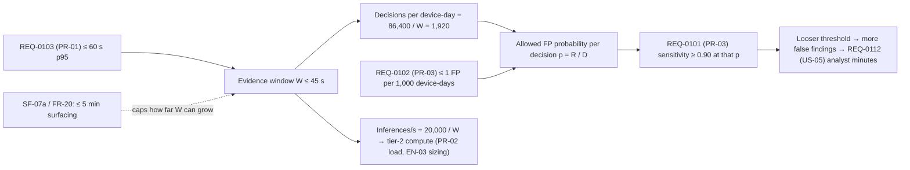

# TS-0001: Which baseline for detection sensitivity, false-alarm rate, finding latency and analyst burden should we freeze at Gate 1?

| Field | Value |
| --- | --- |
| Decision owner | Babar Yousaf, systems-engineering lead (TODO: confirm name and role) |
| Deadline | Gate 1, Week 3 (TODO: insert date) |
| Requirements in scope | REQ-0101, REQ-0102, REQ-0103, REQ-0112 (REQ-0104 held fixed but tightens the squeeze) |
| Status | Draft (Final once every `TODO-LINK` in §2.1 is replaced and EXP-01 is scheduled) |
| Linked ADR | ADR-0001 (TODO: renumber to the next free ADR number) |

- **Device:** AI-Powered Digital Forensics Assistant for Medical Devices.
- **Controlling source:** NovaTechX SPARK 2026 RFP, 41 pages, cited below as "RFP p.N". Requirement IDs (PR-, FR-, SF-, US-, …) are the RFP's own.
- **Sponsor for deviation requests:** the RFP authoring team. Maryam Abbas is listed as owner of Systems & Integration and of AI & Edge Inference (RFP p.31).
- **Authors:** Babar Yousaf, Rooshan Salim Butt, Atif Javed.

---

## 1. Question and scope

**Question.** Which requirement baseline (thresholds, priorities and requirement structure) for detection sensitivity, false-alarm rate, finding latency and analyst burden should we freeze at Gate 1, given that PR-01 and PR-03 cannot be shown to hold together as written?

**Decision owner and authority.** The systems-engineering lead owns the decision. Any change to an RFP target goes to the sponsor as a deviation request (DV-xx) or confirmation query (CQ-xx), listed in §8.3.

**Not in this study.** Detection model, storage product and deployment topology are design trades for Gate 2 and Gate 3 (see NTX-QUEST26-DFTA-TS-002). They inherit the baseline frozen here.

**Reading of the RFP used throughout.** The probabilistic tier screens every monitored device continuously, so that early, novel tampering can be caught (RFP §2.6 p.8; Aim 1 p.3). A per-case deep analysis bounded by PR-07 (≤ 30 s wall-clock, ≤ 2 vCPU per case, RFP p.25) follows each candidate finding. The false-alarm arithmetic in §2.3 applies to the continuous screening decisions. TODO: confirm this reading with the sponsor (CQ-03).

### 1.1 Device brief

| Aspect | Our device |
| --- | --- |
| Users | Hospital SOC analysts and biomedical/clinical engineers trained in network security monitoring and device risk management (RFP p.5) |
| Core job | Detect tampering early and produce a chain-of-custody, ATT&CK-mapped case file. Today this means hand-correlating SIEM, NDR, firewall and MDS2/SBOM data (RFP §2.1 p.5) |
| Use environment | Hospital IT/OT network, passive tap/mirror only (EN-04); up to 20,000 device identities and 5,000 events/s per site (PR-02); fully on-premises core (EN-01). Home devices are reached through vendor cloud APIs |
| Between uses | Runs 24/7; model changes under a pre-specified change envelope (RC-10); drift monitored (VV-04) |
| Buyer | Hospital security budget holders at USD 100k–150k per site per year (RFP §2.5 p.7); sensitive to analyst workload and alert fatigue (US-05) |

### 1.2 Draft requirements (as received)

Priority rule: RFP "Critical" or "High" maps to MUST. Where the RFP states a need but no number, our proposed number is a SHOULD.

| ID | Draft priority | Requirement | Voice | RFP trace | Role |
| --- | --- | --- | --- | --- | --- |
| REQ-0101 | MUST | Detection sensitivity ≥ 0.90 on the versioned VV-02 corpus (incl. infusion-pump drug-library tampering, T0836), criticality-high devices | Customer | PR-03 (p.13), VV-02a/b | **In scope** |
| REQ-0102 | MUST | ≤ 1 false positive per 1,000 device-days, criticality-high devices | Customer | PR-03 (p.13) | **In scope** |
| REQ-0103 | MUST | Candidate finding ≤ 60 s after evidence arrival, p95, hospital-sourced events, nominal load | Customer | PR-01 (p.13), Aim 2 | **In scope** |
| REQ-0104 | MUST | 5,000 events/s/site and 20,000 concurrent identities without evidence loss | Engineer | PR-02 (p.13) | Fixed; drives compute |
| REQ-0105 | MUST | Criticality-high findings surfaced ≤ 5 min with recorded operator acknowledgement; notification for critical findings on critical-high devices ≤ 5 min | Engineer (safety) | SF-07a/b (p.12), FR-20 (p.11) | Fixed; gate |
| REQ-0106 | MUST | Low-confidence findings on criticality-high devices escalated to immediate human review, not automated action | Engineer (safety) | FR-11 (p.10) | Fixed; gate |
| REQ-0107 | MUST | Findings on life-sustaining devices never suppressed, batched or rate-limited by any automated filter | Engineer (safety) | SF-02a/b (p.14) | Fixed; gate |
| REQ-0108 | MUST | No write, command or configuration path to any monitored device; passive tap/mirror only | Engineer (safety) | FR-09, SF-01, EN-04a/b | Fixed; gate |
| REQ-0109 | MUST | Hashing, WORM, ISO/IEC 27037 chain of custody, trusted time, integrity-protected export | Market (legal defensibility) | FR-10, DP-07, DP-08, SE-04 | Fixed; gate |
| REQ-0110 | MUST | No evidence loss across 24 h upstream outage; RPO 0, RTO 4 h; defined degradation order | Engineer | PR-05, RL-02a/b, RL-04 | Fixed; gate |
| REQ-0111 | MUST | AI tier ≤ 30 s wall-clock and ≤ 2 vCPU per case (provisional); degrade to tier 1 on breach | Engineer | PR-07a/b (p.11, p.25) | Fixed; feeds compute |
| REQ-0112 | SHOULD | Analyst time on false findings ≤ 120 min per site per day (team number quantifying US-05) | Customer | US-05 (p.16); TODO-LINK A-10 | **In scope** |

### 1.3 Scope

- **In play:** REQ-0101, 0102, 0103, 0112.
- **Held fixed:** REQ-0104 to REQ-0111. These are safety, integrity and reliability MUSTs we will not trade, so they become gates in §3.
- **Also gated:** EN-01 (offline core), SF-03/FR-08b (no clinical advice) and SF-04/SF-05/FR-23 (coverage honesty) are applied as gates directly from the RFP.
- **Not in conflict:** PR-04 and PR-06 (reports and queries, both Medium priority) are out of scope; see §2.6.

### 1.4 The conflict chains

How to read it:
- The latency cap fixes the evidence window.
- The window fixes how many detection decisions each device gets per day.
- The false-positive bound divided by that count is the specificity each decision must reach while still catching 90 % of attacks.
- Longer windows relieve the squeeze, but SF-07a and FR-20 stop the window growing past about 4 minutes.

---

## 2. Evidence

- **E-xx** figures are cited from the RFP.
- **A-xx** figures are team assumptions. Each must be measured or sourced, and its `TODO-LINK` replaced with a page or measurement record a named teammate opened, before Status becomes Final.

### 2.1 Evidence register

| ID | Quantity | Value | Source / method | Status | Link (opened by) |
| --- | --- | --- | --- | --- | --- |
| E-01 | Sensitivity; FP bound (criticality-high) | ≥ 0.90; ≤ 1 per 1,000 device-days | RFP PR-03 p.13; §3.6 p.24 | Cited | RFP p.13 (TODO: name) |
| E-02 | Candidate-finding latency | ≤ 60 s p95 | RFP PR-01 p.13 | Cited | RFP p.13 |
| E-03 | Load | 5,000 events/s/site; 20,000 identities | RFP PR-02 p.13 | Cited | RFP p.13 |
| E-04 | Criticality-high surfacing; notification | ≤ 5 min; Critical/Critical-High 5 min | RFP SF-07a p.12; FR-20 p.11 | Cited | RFP p.11–12 |
| E-05 | AI-tier budget | ≤ 30 s wall-clock, ≤ 2 vCPU per case (provisional) | RFP PR-07 p.25 | Cited | RFP p.25 |
| E-06 | Storage growth | 50–100 GB per 1,000 devices per month (provisional) | RFP PR-08 p.25 | Cited | RFP p.25 |
| E-07 | Full-hospital sizing | 5,000–7,500 devices; 16–24 cores; 32–64 GB; 2,000+ GB | RFP §3.6.1 p.25 | Cited | RFP p.25 |
| E-08 | Outage / recovery | 24 h; RPO 0; RTO 4 h | RFP PR-05 p.13; RL-02b p.16 | Cited | RFP p.13, p.16 |
| E-09 | Home telemetry rate | 0.5–1 events/s per household (provisional) | RFP Figure 12 p.23 | Cited | RFP p.23 |
| A-01 | Mean stored size of one normalized MDFE event | 1 KB | Normalize 10,000 sample SIEM/firewall/NDR events; bytes ÷ count | Assumed | TODO-LINK |
| A-02 | CPU per event to parse, hash, normalize | 100 µs | Benchmark prototype normalizer, one core | Assumed | TODO-LINK |
| A-03 | Pipeline allowance outside the window (flush + queue + inference + write), p95 | 15 s | End-to-end timing on prototype | Assumed | TODO-LINK |
| A-04 | Criticality-high devices per site | 2,000 (10 % of 20,000) | Sponsor's criticality definition or partner inventory | Assumed | TODO-LINK |
| A-05 | Analyst time per false finding | 15 min | Tabletop, 3 analysts, 10 synthetic findings. The RFP's workflow was checked only with a student peer (p.5), so this needs a working analyst | Assumed | TODO-LINK |
| A-06 | Cores for tier-2 screening | 8 (half of the 16-core full-hospital minimum, E-07) | Reference server for prototype | Assumed | TODO-LINK |
| A-07 | Chance an unrelated independent-source event (another source class, same device) falls in a 225 s window | 0.02 | Count over one day of benign multi-source logs (EXP-01a) | Assumed | TODO-LINK |
| A-08 | Fraction of VV-02 attack scenarios leaving evidence in ≥ 2 source classes | 0.8 | Count from VV-02 ground-truth labels | Assumed | TODO-LINK |
| A-09 | Tolerable analyst time on false findings | 120 min/site/day | SOC analyst interviews (quantifies US-05) | Assumed | TODO-LINK |

**Unit and definition checks.**
- A device-day is one device monitored for 24 h.
- PR-03's bound applies to criticality-high devices only, so it multiplies A-04, not 20,000.
- KB means 10³ bytes.
- Two RFP inconsistencies were found and are reported in §2.6.

### 2.2 Latency budget → evidence window

W = L_cap − T_pipeline, with T_pipeline = 15 s (A-03).

| Latency cap for tier-2 candidate findings | Why this cap | Window W |
| --- | --- | --- |
| 60 s | PR-01 as drafted | **45 s** |
| 240 s (4 min) | Leaves 60 s for notification, so SF-07a/FR-20's 5-min surfacing still holds measured from evidence arrival | **225 s** |
| 600 s (10 min) | Previous draft of this study | 585 s, but **breaks SF-07a** (see B4, §3) |

PR-07's per-case analysis (≤ 30 s) starts after the candidate finding: 60 + 30 = 90 s for B0, and 240 + 30 = 270 s < 300 s for B2/B3.

### 2.3 Detection budget (the budget that decides this study)

Decisions per device-day: D = 86,400 / W. Allowed false-positive probability per decision: p = R / D, where R is the false findings allowed per device-day (0.001 under PR-03).

| Baseline | W | D | Allowed p per finding decision | p at the 0.90-sensitivity operating point |
| --- | --- | --- | --- | --- |
| B0 as drafted | 45 s | 1,920 | 0.001 / 1,920 = **5.2 × 10⁻⁷** | 5.2 × 10⁻⁷ |
| B1 relaxed FP | 45 s | 1,920 | 0.005 / 1,920 = **2.6 × 10⁻⁶** | 2.6 × 10⁻⁶ |
| B2 split latency | 225 s | 384 | 0.001 / 384 = **2.6 × 10⁻⁶** | 2.6 × 10⁻⁶ |
| B3 corroboration-gated | 225 s | 384 | 2.6 × 10⁻⁶ total, split equally between two routes | single-source detector may run at **6.5 × 10⁻⁵** |

How B3's figure is derived:
- Route H, high score alone, gets half the budget: p_H = 1.3 × 10⁻⁶.
- Route L, lower score plus an independent second source, gets the other half. A false finding on route L needs two coincidences, so p_L × p_c = 1.3 × 10⁻⁶. With p_c = 0.02 (A-07), p_L = 6.5 × 10⁻⁵.
- That is 125 times looser than B0, and the PR-03 numbers are unchanged.

Sensitivity under B3: attacks seen in ≥ 2 source classes (fraction q, A-08) are caught on route L with sensitivity s_L. The rest need route H, with sensitivity s_H. Then

  q · s_L + (1 − q) · s_H ≥ 0.90

With q = 0.8 and s_L = 0.95, this needs s_H ≥ 0.70.

Precedent in the RFP: FR-05b already requires a second source (a VEX statement) before a CVE becomes a finding (p.10). FR-13 already defines confidence as a combination across tiers (p.10). B3 extends that logic to anomaly findings.

Caveats:
- Decisions are treated as independent. Real false alarms cluster, so the per-decision figures are conservative.
- Benign activity such as maintenance can trigger several sources at once. p_c must therefore be measured on windows where the detector already scored high, not only unconditionally (EXP-01b).

### 2.4 Analyst workload budget (US-05)

False findings per day = R × 2,000 (A-04). Minutes = findings × 15 (A-05).

| Baseline | False findings/day | Min/site/day | REQ-0112 (≤ 120) |
| --- | --- | --- | --- |
| B0 | 2 | **30** | Met |
| B1 | 10 | **150** | Missed |
| B2 | 2 | **30** | Met |
| B3 | 2 | **30** | Met |

Every route-L finding is a real finding and goes through FR-11 human review, so it is counted here. Sub-threshold observations are not triaged.

### 2.5 Compute budget

**Tier 1 (all baselines):**
- Nominal: 5,000 events/s × 100 µs (A-02) = 0.5 core.
- Catch-up after a 24 h outage (PR-05): the backlog is 5,000 × 86,400 = 432 M events. Draining it in 12 h while live traffic continues needs 5,000 + 432 M ÷ 43,200 s = **15,000 events/s = 1.5 cores**.
- Against the 16-core minimum (E-07), tier 1 is not a constraint.

**Tier-2 screening:** inferences/s = 20,000 ÷ W. The CPU time allowed per inference within 8 cores (A-06) is 8 ÷ rate.

| Baseline | Inferences/s | Allowed CPU per inference |
| --- | --- | --- |
| B0, B1 | 444 | **18 ms** |
| B2, B3 | 89 | **90 ms** |

B3's corroboration check is a per-device lookup across sources, small next to inference. A model needing more than 18 ms per inference forces GPU purchase under B0/B1; B2/B3 stay on CPU up to 90 ms. Restricting tier 2 to criticality-high devices would cut this five- to ten-fold, but compute is not binding, so that option goes to TS-0002.

### 2.6 Storage cross-check (not a driver here; two RFP inconsistencies found)

**PR-08 storage.** At 50–100 GB per 1,000 devices per month (E-06), 20,000 devices need 1.0–2.0 TB/month:
- 90-day window (PR-06): 3–6 TB.
- Two replicas for RPO 0 (RL-02b): **6–12 TB/site**.

**PR-02 at full rate.** 5,000 events/s sustained at 1 KB (A-01) gives 432 GB/day ≈ **13 TB/month**, 6.5 to 13 times PR-08.

**Inconsistency 1.** PR-08 implies an average rate of 1,000–2,000 GB ÷ (2.592 × 10⁶ s × 1 KB) = **386–772 events/s**, only 8–15 % of PR-02. Either PR-02 is a peak rate, or PR-08 underestimates. Ask the sponsor which (CQ-04).

**Inconsistency 2.** EN-03 sizing (§3.6.1) stops at 5,000–7,500 devices for a full hospital, but PR-02 requires 20,000 identities. The 16–24 core figure therefore does not yet cover PR-02 (CQ-05).

Storage is the same for every baseline in §4, so these issues go to TS-0002 (storage and sizing trade, Gate 2).

### 2.7 Verification-size budget

- **False positives:** showing ≤ 1 FP per 1,000 device-days at 95 % confidence with zero false findings needs **3,000** device-days of benign replay (rule of three: 3 ÷ R). R = 0.005 needs **600**.
- **Sensitivity:** showing ≥ 0.90 at 95 % confidence needs **29** positive VV-02 instances with no misses (0.9²⁹ ≈ 0.047), or **46** if one miss is allowed.
- **B3 extras:** also needs per-route sensitivities and the conditional p_c, so it carries more verification work (scored in C4).
- TODO: confirm VV-02 has ≥ 29 positive instances.

---

## 3. Gates (pass/fail, with thresholds)

Fixed MUSTs are gates. A baseline that fails any gate is removed before scoring.

| Gate | Threshold | RFP source | B0 | B1 | B2 | B3 | B4 |
| --- | --- | --- | --- | --- | --- | --- | --- |
| G1 No-write, passive | Zero write/command/config code paths; tap/mirror only | FR-09, SF-01, EN-04a/b | Pass | Pass | Pass | Pass | Pass |
| G2 Evidence integrity | Hash at intake, WORM, 27037 custody, trusted time, protected export | FR-10, DP-07, DP-08, SE-04 | Pass | Pass | Pass | Pass | Pass |
| G3 Offline core | Tier-1 analysis, preservation, reporting with outbound access off | EN-01 | Pass | Pass | Pass | Pass | Pass |
| G4 Outage / recovery | 0 loss over 24 h; RPO 0; RTO ≤ 4 h; catch-up ≥ 15,000 events/s (§2.5) | PR-05, RL-02a/b, RL-04 | Pass | Pass | Pass | Pass | Pass |
| G5 Load | 5,000 events/s, 20,000 identities, 0 loss (§2.5) | PR-02 | Pass | Pass | Pass | Pass | Pass |
| G6 Criticality-high surfacing | Finding surfaced to operator ≤ 5 min from evidence arrival, positive ack recorded | SF-07a/b, FR-20 | Pass (≤ 90 s) | Pass | Pass (≤ 270 s) | Pass (≤ 270 s) | **Fail** (10 min) |
| G7 Low-confidence escalation | Every low-confidence finding on a criticality-high device goes to immediate human review | FR-11 | Pass | Pass | Pass | Pass | **Fail** (leads queued, not escalated) |
| G8 Life-sustaining findings | No suppression, batching or rate-limiting of findings | SF-02a/b | Pass | Pass | Pass | Pass, if sponsor confirms (CQ-01) | **Fail** (daily lead cap) |
| G9 Coverage honesty | Partial or degraded analysis never shown as complete or as "no findings" | SF-04, SF-05a/b, FR-23b | Pass | Pass | Pass | Pass | Pass |
| G10 No clinical advice | No diagnostic, therapeutic or patient-management output | SF-03a/b, FR-08b | Pass | Pass | Pass | Pass | Pass |

**B3 on G8.** In B3, corroboration is part of the finding definition, inside FR-13's combination function: it decides whether a finding exists. It is not a filter applied after a finding exists. Sub-threshold scores are stored on the device timeline as labelled inferred observations (FR-22) and never shown as absence of findings (SF-05). If the sponsor rules that this still counts as an automated filter under SF-02b, B3 is eliminated (trigger R6).

**B4** is the Alerts-and-Leads baseline from this study's previous draft. It fails three safety gates and is eliminated.

### 3.1 As-drafted baseline tested against its own MUSTs

B0 passes every gate. However, REQ-0101, 0102 and 0103 close together only if one single-source detector reaches 0.90 sensitivity at a per-decision false-positive probability of **5.2 × 10⁻⁷** (specificity 0.99999948) on 45-second windows (§2.3). No measurement or source shows any candidate from TS-002 can do this. Verifying it would also need ≥ 3,000 zero-false-finding device-days and ≥ 29 positive instances (§2.7).

**Verdict:** **not demonstrated feasible** at Gate 1. B0 is kept as the reference, and §7 gives the measurement that would make it acceptable (R3).

---

## 4. Alternatives

Alternatives are requirement baselines, not designs.

| ID | Baseline | What changes | Kind of change | Concept that could meet it |
| --- | --- | --- | --- | --- |
| B0 | As drafted | Nothing | Reference | Streaming rules + per-device anomaly model on 45 s windows; GPU likely if > 18 ms/inference |
| B1 | Relax the FP number | PR-03 bound: 1 → 5 per 1,000 device-days | Number | B0 with a lower threshold |
| B2 | Split latency by tier | PR-01 becomes two requirements: tier-1 ≤ 60 s p95; tier-2 ≤ 4 min p95 (SF-07a's 5 min still holds) | **Structure** (one requirement becomes two) | Streaming tier 1; tier-2 CPU micro-batch every 225 s |
| B3 | Corroboration-gated tier-2 findings (**non-obvious**) | B2's split, plus a new derived requirement: a tier-2 anomaly on a criticality-high device becomes a finding only if score ≥ θ_H, or score ≥ θ_L **and** an independent source class reports the same resolved device (FR-12) in the same window. PR-03 numbers unchanged | **Structure** (changes what counts as a finding, following FR-05b) | B2 pipeline + cross-source corroboration join keyed on resolved identity; sub-threshold scores written to the timeline as inferred observations |
| B4 | Alerts + Leads (previous draft) | Tier 2 ≤ 10 min; low scores go to a non-paging lead queue capped per day | Use model | Eliminated: G6, G7, G8 |

**Why B3 is non-obvious.** It moves no threshold. It changes the structure of the finding requirement so that one of the two RFP-native ideas, multi-source correlation (Aim 2, §2.1 step 5), does the false-alarm work that a single detector cannot.

**Considered in screening and not carried:**
- **Tier 2 only after a tier-1 trigger** (a case-triggered use model). Sensitivity to novel attacks would be capped by tier-1 coverage, which contradicts the early-tampering goal (§2.6 p.8). It adds nothing the gates do not already cover.
- **Tier 2 on criticality-high devices only.** It saves compute, but compute is not binding (§2.5). Deferred to TS-0002.

---

## 5. Criteria, anchored scales and swing weights

### 5.1 Criteria and scales (anchored before scoring; scores rounded to integers)

| ID | Voice | Criterion | Unit | 0 anchor | 100 anchor | Function |
| --- | --- | --- | --- | --- | --- | --- |
| C1 | Customer | Time to candidate finding for a novel attack (tier-2 path), p95 | min | 30 | 1 | Linear: 100 × (30 − t) / 29 |
| C2 | Customer | Analyst time on false findings (US-05) | min/site/day | 240 | 0 | Linear: 100 × (240 − m) / 240 |
| C3 | Engineer | Feasibility margin: allowed per-decision FP probability for the detector at its 0.90 operating point | probability | 10⁻⁷ | 10⁻⁴ | Log: 100 × (log₁₀ p + 7) / 3 |
| C4 | Engineer | Technical risk: unmeasured inputs the feasibility case depends on (detector ROC, p_c, q) | count | 4 | 0 | Linear: 100 × (4 − n) / 4 |
| C5 | Market | RFP targets needing a sponsor deviation (contract and schedule risk) | count | 3 | 0 | Linear: 100 × (3 − k) / 3 |
| C6 | Market | Supply risk: CPU per tier-2 inference allowed before GPUs must be bought (§2.5) | ms | 10 | 1,000 | Log: 100 × (log₁₀ ms − 1) / 2 |

### 5.2 Double-counting checks

- **False-alarm rate and analyst workload** are one effect, so they appear once, in C2. C3 measures statistical achievability, not people's time.
- **C3 and C4** are deliberately opposed. C3 is how much margin a baseline has; C4 is how much of that margin rests on numbers nobody has measured. B3 scores high on C3 and low on C4.
- **C3 and C6** both grow with W but diverge: B1 improves C3 without improving C6.
- **Price and hosting cost** (RFP §2.5) are the same for every baseline, so they are left out. The only part that varies is GPU need, captured once in C6.

### 5.3 Swing weights (by how much each swing matters across B0–B3)

| Rank | Swing | Points | Reason |
| --- | --- | --- | --- |
| 1 | C3: 5.2 × 10⁻⁷ → 6.5 × 10⁻⁵ | 30 | Decides whether PR-03 can be met at all |
| 2 | C4: 3 → 1 unmeasured inputs | 20 | A margin built on guesses can disappear at Gate 3 |
| 3 | C2: 150 → 30 min/day | 15 | Alarm fatigue; US-05 is a High-priority RFP need |
| 3 | C5: 1 → 0 deviations | 15 | A rejected deviation stalls Gate 1 |
| 5 | C1: 4 → 1 min | 10 | Both ends are within SF-07a's 5 min, so this is a narrow safety swing |
| 5 | C6: 18 → 90 ms | 10 | GPU procurement is a supply risk with a fallback |
| | **Total** | **100** | |

---

## 6. Scores and totals

### 6.1 Raw values

| Criterion | B0 | B1 | B2 | B3 |
| --- | --- | --- | --- | --- |
| C1 time to finding (min) | 1 | 1 | 4 | 4 |
| C2 analyst min/day | 30 | 150 | 30 | 30 |
| C3 per-decision p | 5.2 × 10⁻⁷ | 2.6 × 10⁻⁶ | 2.6 × 10⁻⁶ | 6.5 × 10⁻⁵ |
| C4 unmeasured inputs | 1 | 1 | 1 | 3 |
| C5 deviations | 0 | 1 | 1 | 1 |
| C6 ms per inference | 18 | 18 | 90 | 90 |

### 6.2 Scores and weighted totals

| Criterion (weight) | B0 | B1 | B2 | B3 |
| --- | --- | --- | --- | --- |
| C1 (10) | 100 | 100 | 90 | 90 |
| C2 (15) | 88 | 38 | 88 | 88 |
| C3 (30) | 24 | 47 | 47 | 94 |
| C4 (20) | 75 | 75 | 75 | 25 |
| C5 (15) | 100 | 67 | 67 | 67 |
| C6 (10) | 13 | 13 | 48 | 48 |
| **Weighted total** | **61.7** | **56.2** | **66.2** | **70.3** |

Total = Σ (weight × score) / 100. Example, B3: (10×90 + 15×88 + 30×94 + 20×25 + 15×67 + 10×48) / 100 = 70.25.

Different criteria favour different options:
- B0 leads on C1 and C5.
- B0, B2 and B3 tie on C2.
- B3 leads on C3 but is worst on C4.
- B3 and B2 differ only on C3 (+47) and C4 (−50), so the choice between them is margin against risk.

---

## 7. Sensitivity and break-even point

### 7.1 Weight swings (±25 %, others rescaled to keep the total at 100)

| Weight changed | New weight | B3 − B2 | B3 − B0 | Leader |
| --- | --- | --- | --- | --- |
| C1 +25 % | 12.5 | +3.99 | +8.03 | B3 |
| C1 −25 % | 7.5 | +4.21 | +9.07 | B3 |
| C2 +25 % | 18.75 | +3.92 | +8.17 | B3 |
| C2 −25 % | 11.25 | +4.28 | +8.93 | B3 |
| C3 +25 % | 37.5 | +8.70 | +15.13 | B3 |
| C3 −25 % | 22.5 | −0.50 | +1.97 | **B2** |
| C4 +25 % | 25 | +0.72 | +4.89 | B3 |
| C4 −25 % | 15 | +7.48 | +12.21 | B3 |
| C5 +25 % | 18.75 | +3.92 | +6.72 | B3 |
| C5 −25 % | 11.25 | +4.28 | +10.38 | B3 |
| C6 +25 % | 12.5 | +3.99 | +9.29 | B3 |
| C6 −25 % | 7.5 | +4.21 | +7.82 | B3 |

**Findings.**
- **Robust:** splitting PR-01 by tier (shared by B2 and B3) leads in all 12 swings. B0 and B1 never lead.
- **Weight break-evens:** B3 beats B2 while C3's weight is ≥ **23.3** (base 30) and C4's weight is ≤ **26.1** (base 20). Both margins are narrow, so the B3-vs-B2 choice is settled by measurement, not by weights.

### 7.2 Break-even on the deciding input

The deciding input is **p_c**, the chance that an unrelated event from an independent source class lands on the same device in the same 225 s window.

- B3's advantage shrinks as p_c grows: its allowed detector rate is 1.3 × 10⁻⁶ ÷ p_c.
- B3 and B2 tie when C3(B3) = 80.3, which means p_L = 2.6 × 10⁻⁵, which means **p_c = 0.05**.
- **Break-even: p_c ≈ 0.05.** Below it, B3 wins; above it, corroboration adds little, and B2 wins because it is simpler and has fewer unmeasured inputs.

Second deciding input, the single-source detector's achieved rate p\* at 0.90 sensitivity:

| Measured p\* | Choose |
| --- | --- |
| ≤ 5.2 × 10⁻⁷ on 45 s windows | B0: RFP unchanged, no deviation |
| ≤ 2.6 × 10⁻⁶ on 225 s windows | B2: no corroboration needed |
| > 2.6 × 10⁻⁶ | B3 only, if p_c < 0.05 and the q condition in §2.3 holds |

### 7.3 Cheapest experiment that settles it

**EXP-01a: count p_c (about one afternoon, no model needed).**
- Take one day of benign multi-source logs (SIEM, firewall, NDR) for a device population.
- Resolve identities (FR-12).
- Split time into 225 s windows per device and count the fraction with an event from a second source class.
- If the unconditional p_c is already > 0.05, B2 wins and the study is settled.

**EXP-01b: only if EXP-01a gives < 0.05.**
- Run TS-002's robust statistical baseline on VV-02 replay: ≥ 3,000 criticality-high device-days and ≥ 29 positive instances.
- Measure p_c on the windows where the detector scored ≥ θ_L (the conditional p_c).
- Read off p\* at 0.90 sensitivity.
- Count q from the VV-02 labels.
- Cost: about 3–5 team-days on existing compute.

---

## 8. Decision, revised requirements and change log

### 8.1 Decision

Freeze **B3 (latency split by tier + corroboration-gated tier-2 findings)** at Gate 1:
- It is the only baseline that keeps PR-03's numbers unchanged while giving the detector about 125 times more margin.
- It passes all ten gates, including the SF-07a, FR-11 and SF-02b safety gates that eliminated this study's previous recommendation.
- It leads in 11 of 12 weight swings.

**Conditional on EXP-01:**
- If p_c ≥ 0.05, collapse to B2 by deleting REQ-0113. B2 is a strict subset of B3, so this costs no rework.
- If p\* ≤ 2.6 × 10⁻⁶, also collapse to B2.

Recorded in ADR-0001.

### 8.2 Revised requirement baseline

| ID | Priority | Requirement | Voice | Changed? |
| --- | --- | --- | --- | --- |
| REQ-0101 | MUST | Sensitivity ≥ 0.90 on VV-02, criticality-high (PR-03) | Customer | No |
| REQ-0102 | MUST | ≤ 1 false finding per 1,000 criticality-high device-days (PR-03) | Customer | No |
| REQ-0103a | MUST | Tier-1 (deterministic) candidate findings ≤ 60 s p95 from evidence arrival, nominal load | Customer | Yes (CL-01) |
| REQ-0103b | MUST | Tier-2 (probabilistic) candidate findings ≤ 4 min p95 from evidence arrival, nominal load; SF-07a surfacing ≤ 5 min unchanged | Customer | Yes (CL-01) |
| REQ-0104 – REQ-0111 | as §1.2 | Unchanged | — | No |
| REQ-0112 | SHOULD | Analyst time on false findings ≤ 120 min/site/day (quantifies US-05) | Customer | No (number proposed to sponsor, CQ-02) |
| REQ-0113 | MUST | Tier-2 anomaly on a criticality-high device becomes a finding only if score ≥ θ_H, or score ≥ θ_L and an independent evidence-source class reports the same resolved device identity (FR-12) in the same window. Sub-threshold scores are stored as labelled inferred observations (FR-22), never shown as findings or as absence of findings (SF-05). Derived from FR-13 | Engineer | New (CL-02) |

### 8.3 Change log

| Row | Requirement | Old value | New value | Reason | Evidence |
| --- | --- | --- | --- | --- | --- |
| CL-01 | REQ-0103 (PR-01) | ≤ 60 s p95 for all candidate findings | 0103a tier 1 ≤ 60 s; 0103b tier 2 ≤ 4 min | Window 45 → 225 s: decisions/day 1,920 → 384; tier-2 compute 5× lower; still within SF-07a | §2.2, §2.3, §2.5, §6 |
| CL-02 | REQ-0113 (from FR-13) | — | Corroboration-gated tier-2 findings | Allowed detector false-positive rate 5.2 × 10⁻⁷ → 6.5 × 10⁻⁵ with PR-03 unchanged | §2.3, §3, §7 |
| CL-03 | REQ-0112 (US-05) | "Bound alert volume" (no number) | ≤ 120 min/site/day | Makes US-05 verifiable (VV-01 requires a quantified criterion) | §2.4 |

**Sponsor items, filed with the ADR:**
- **DV-01:** deviation for CL-01.
- **CQ-01:** confirm that REQ-0113 is a finding definition, not an SF-02b filter.
- **CQ-02:** accept the 120-min figure.
- **CQ-03:** confirm continuous tier-2 screening (§1).
- **CQ-04 and CQ-05:** resolve the PR-02 vs PR-08 and PR-02 vs EN-03 inconsistencies (§2.6).

---

## 9. Reversal triggers

| ID | Trigger | Action |
| --- | --- | --- |
| R1 | EXP-01 shows conditional p_c ≥ 0.05 | Collapse to B2 (delete REQ-0113) |
| R2 | Single-source p\* ≤ 2.6 × 10⁻⁶ at 0.90 sensitivity, W = 225 s | Collapse to B2 |
| R3 | p\* ≤ 5.2 × 10⁻⁷ at W = 45 s | Reopen; B0 (no deviation) becomes viable |
| R4 | q · s_L + (1 − q) · s_H < 0.90 on VV-02 | B3 cannot meet PR-03; reopen |
| R5 | Sponsor rejects DV-01 | Reopen with PR-01 as a gate; only B0/B1 remain |
| R6 | Sponsor rules REQ-0113 is an automated filter under SF-02b | B3 eliminated; adopt B2 |
| R7 | Cross-source identity-match rate on VV-02 below the team threshold (TODO: set, e.g. 95 %) | Corroboration unreliable; re-score B3 |
| R8 | Criticality-high devices per site > 4,000 (A-04 off by 2×) | Re-run §2.3–2.4 |
| R9 | VV-02 has < 29 positive instances | PR-03 unverifiable; escalate to sponsor |

---

## 10. SysML mapping for Week 2

The RFP model is built in CATIA Magic (Figures 1–13). Add the TS-0001 elements to it rather than starting a new model.

| Study element | SysML element (v1, as in the existing model) | Where it connects |
| --- | --- | --- |
| REQ-0101 … REQ-0113 | «requirement» with id, text, priority | «deriveReqt» from PR-01, PR-03, US-05, FR-13 in the existing Performance & Reliability and Functional groups (Figure 1) |
| Gates G1–G10 | Existing RFP «requirement» elements | «satisfy» from the ATT&CK Mapping Engine block (tier 2) and Clinical-Safety Guardrail block (G6–G8); «verify» from V-01–V-06 (TS-002) |
| Baselines B0–B4 | Abstract block `DetectionBaseline`, specialized by blocks B0…B4 (or the tool's variability extension, if enabled) | B4 kept with a rationale note recording which gates it fails |
| Criteria C1–C6 | Value properties of `DetectionBaseline` with units | Raw values from §6.1 |
| Budgets §2.2–2.7 | Constraint blocks: WindowBudget (W = Lcap − Tpipe), DecisionRate (D = 86,400 / W), FPBudget (p = R / D), CorroborationBudget (p_L = p_branch / p_c), WorkloadBudget, ComputeBudget (ms = cores ÷ (N / W)) | Parametric diagram bound to the baseline value properties |
| Scoring functions | Constraint blocks LinearScore, LogScore with anchor parameters | §5.1 |
| Utility | Constraint block `Utility { U = Σ wᵢ · sᵢ }` | Weights from §5.3 |
| Sensitivity | Parametric run sweeping each wᵢ by ±25 % | Reproduces §7.1 |
| EXP-01a/b | «testCase» verifying REQ-0102 and REQ-0113 | Outputs p_c, p\*, q feed triggers R1–R4 |
| ADR-0001 | «rationale» / comment linked to REQ-0103a/b, REQ-0113 | — |
